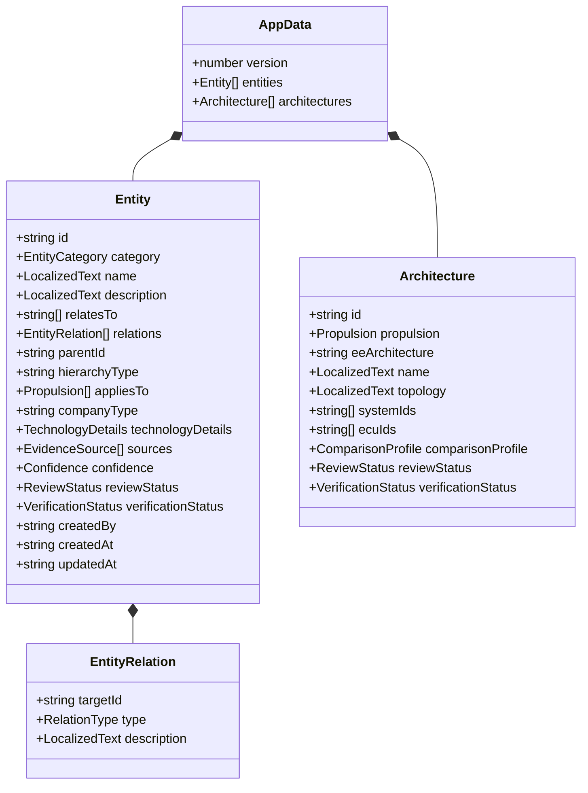
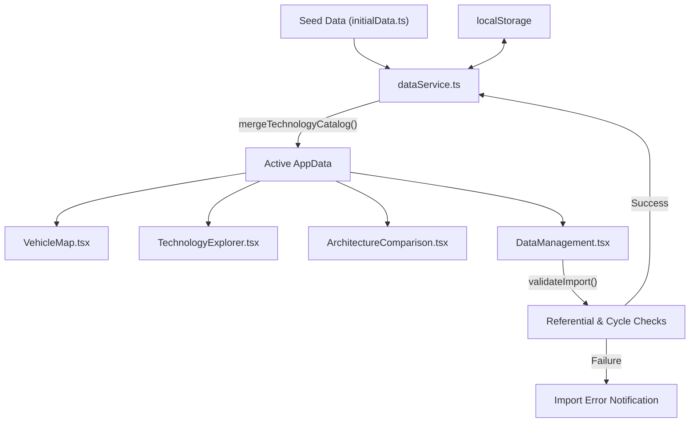

# ATIM Architecture Documentation

This document describes the current technical architecture, data model, component structure, persistence mechanism, and interaction flows of the Automotive Technology Intelligence Map (ATIM).

---

## 1. Technology Stack Overview

| Layer | Technology | Version | Purpose |
|---|---|---|---|
| Runtime / Framework | React | 19.1.1 | Single-page application UI |
| Language | TypeScript | ~5.9.2 | Type safety across models and services |
| Build Tool | Vite | 7.1.4 | Fast development server and production bundler |
| Styling | Tailwind CSS + CSS | 4.1.13 | Utility classes + custom responsive theme (`styles.css`) |
| Graph Framework | `@xyflow/react` | ^12.8.4 | Interactive canvas, nodes, handles, edges |
| Layout Engine | `elkjs` | ^0.12.1 | Layered orthogonal graph layout (**dynamically imported**) |
| Icons | `lucide-react` | ^0.468.0 | UI icon set |
| i18n | `i18next` + `react-i18next` | ^25.5 / ^16.0 | Bilingual localization (English default / Chinese) |
| Unit Testing | Vitest | ^5.1.0 | Fast unit tests for models and services |
| Storage | Browser `localStorage` | Web API | Local-first persistence; no remote backend |

---

## 2. Directory Structure & Module Breakdown

```text
src/
├── main.tsx                           # Application entry point
├── App.tsx                            # App shell, global navigation, and inline views
├── types.ts                           # Comprehensive data model definitions
├── i18n.ts                            # i18next configuration and bilingual dictionary
├── styles.css                         # Global CSS styles (dark industrial theme)
├── components/
│   ├── VehicleMap.tsx                 # Architecture graph canvas, toolbar, ELK layout
│   └── EntityDetails.tsx              # Detailed inspection drawer for selected entity
├── data/
│   └── initialData.ts                 # Seed entities, relations, and reference architectures
├── pages/
│   ├── TechnologyExplorer.tsx         # Domain-based technology exploration & graph traversal
│   ├── ArchitectureComparison.tsx     # Side-by-side comparison (table & card views)
│   └── DataManagement.tsx             # Full CRUD management, validation, import/export, audit log
└── services/
    ├── dataService.ts                 # Local storage CRUD, schema validation, migration, history
    ├── graphInteractions.ts           # 1-degree neighbor discovery, highlight calculation
    ├── technologyCatalog.ts           # Technology filtering and domain-based relationship links
    ├── entitySearch.ts                # Full-text bilingual entity search
    ├── architectureComparison.ts      # Comparison matrix generation across dimensions
    ├── comparisonDimensions.ts        # Definition of 22 engineering comparison dimensions
    ├── dataQuality.ts                 # Automated data quality audit engine
    └── core.test.ts                   # 28 unit tests covering services, models, and comparisons
```

---

## 3. Page Organization & Routing

### Current Implementation
ATIM is currently a single-page application with **state-based view switching** (`useState<'map' | 'explorer' | 'comparison' | 'industry' | 'radar' | 'learning' | 'data'>('map')`). There is no client-side URL router library (e.g., React Router).

The 7 primary views are organized as follows:

| View ID | Name | Source Location | Implementation State |
|---|---|---|---|
| `map` | Vehicle Architecture Map | `src/components/VehicleMap.tsx` | Dedicated component; full-featured |
| `explorer` | Technology Explorer | `src/pages/TechnologyExplorer.tsx` | Dedicated page component; full-featured |
| `comparison` | Architecture Comparison | `src/pages/ArchitectureComparison.tsx` | Dedicated page component; full-featured |
| `data` | Data Management | `src/pages/DataManagement.tsx` | Dedicated page component; full-featured |
| `industry` | Industry & Company Map | `src/App.tsx` (inline component `IndustryPage`) | Basic company card directory |
| `radar` | Technology Radar | `src/App.tsx` (inline component `RadarPage`) | Qualitative maturity buckets with static IDs |
| `learning` | My Learning Center | `src/App.tsx` (inline component `LearningPage`) | Personal favorites and notes editor |

### Current Limitations
- Views are not bookmarkable via distinct URL paths.
- Browser back/forward navigation does not switch application views.
- `IndustryPage`, `RadarPage`, and `LearningPage` are embedded directly within `App.tsx` rather than modularized in `src/pages/`.

---

## 4. Core Data Model (`src/types.ts`)



### Entity Categories (9 types)
`system`, `ecu`, `sensor`, `actuator`, `hardware`, `network`, `technology`, `standard`, `company`.

### Relationship Types (15 types in `src/types.ts`)
`related_to`, `contains`, `part_of`, `controls`, `monitors`, `communicates_with`, `connected_to`, `powered_by`, `distributes_power_to`, `depends_on`, `implements`, `uses`, `integrates`, `transports`, `defines`.

### Relationship Categories (6 semantic groups)
Mapped via `getRelationshipCategory(type: RelationType)` in `src/services/graphInteractions.ts`:
- **Communication**: `communicates_with`, `transports`
- **Control**: `controls`, `monitors`
- **Dependency**: `depends_on`, `uses`, `implements`
- **Power Flow**: `powered_by`, `distributes_power_to`
- **Network**: `connected_to`
- **Unclassified**: Fallback category (`related_to`, `contains`, `part_of`, `integrates`, `defines`, etc.)

---

## 5. Persistence, Validation & Data Flow

### Local Storage Schema
Data is partitioned across four distinct localStorage keys:
1. `automotive-map:data:v1`: Serialized `AppData` (version 2 schema).
2. `automotive-map:history:v1`: Array of `ChangeRecord` audit log entries (capped at 500).
3. `automotive-map:learning:v1`: User `favorites` array and `notes` key-value pairs.
4. `atim-language`: Active language code (`'en'` or `'zh'`).

### Data Flow Diagram



### Data Validation Rules (`validateImport`)
- Schema version must be 1 or 2 (v1 is automatically migrated to v2).
- Entity IDs must match `/^[a-z0-9][a-z0-9-]*$/`.
- Duplicate IDs are rejected.
- All references in `relatesTo`, `relations[].targetId`, and architecture `systemIds`/`ecuIds` must exist in the entity pool (referential integrity).
- Hierarchy cycles (`contains` / `part_of`) are detected and rejected.
- **Agent Governance**: Entities with `createdBy: 'Agent'` cannot be imported with `reviewStatus: 'Approved'`.

---

## 6. Vehicle Architecture Map Engine

### 6.1 Data Filtering Pipeline
1. **Propulsion Selection**: Filters systems and ECUs using `architecture.systemIds` and `appliesTo`.
2. **E/E Architecture Filter**: Injects/replaces controllers specific to Distributed, Domain, Zonal, or Centralized layouts.
3. **View Mode Filtering**:
   - **System Structure** (`structure`): Hides inter-system communication/control edges to emphasize hierarchical system composition.
   - **Relationship View** (`relationship`): Hides internal composition edges (`contains`, `part_of`) to highlight external communication, power flow, and control relationships.
   - **Full Graph** (`full`): Displays all visible nodes and edges simultaneously.

### 6.2 Hierarchy Architecture & Derivation Mechanism
Hierarchy is managed through three distinct mechanisms, preventing oversimplification:
1. **Human-Maintained & Stored Hierarchy**: Entities with existing `parentId` and `hierarchyType` (`composition` | `subsystem`) stored in AppData or JSON imports are preserved as primary ground truth.
2. **Automatic Runtime Derivation**: During `readData` / `validateImport` and seed data initialization, if an entity has no `parentId`, the system derives it deterministically:
   - If parent `A` contains relation `{ type: 'contains', targetId: 'B' }` and `!B.parentId`: `B.parentId = A.id` and `B.hierarchyType = 'composition'`.
   - If child `A` contains relation `{ type: 'part_of', targetId: 'B' }` and `!A.parentId`: `A.parentId = B.id` and `A.hierarchyType = 'subsystem'`.
3. **Legacy Migration Preservation**: In version 1 data without typed relations, untyped `relatesTo` links are converted to `related_to` (unspecified semantics); existing legacy `parentId` fields are preserved, while no speculative hierarchy is created. Cycle detection and dangling parent reference validations run across all entities.
*Agent Rule*: Agents must never guess or fabricate hierarchy from node names or visual layout. All hierarchy must reflect verified engineering containment or subsystem boundaries.

### 6.3 ELK.js Layout Engine
- **Dynamic Loading**: ELK is loaded asynchronously via `import('elkjs/lib/elk.bundled.js')` to avoid blocking main bundle initialization.
- **Algorithm**: ELK Layered (`org.eclipse.elk.layered`).
- **Configuration**:
  - `elk.direction`: `'DOWN'`
  - `elk.spacing.nodeNode`: `60`
  - `elk.layered.spacing.nodeNodeBetweenLayers`: `80`
  - `elk.edgeRouting`: `'ORTHOGONAL'`
- **Fallback**: When at top-level overview or when ELK is pending, nodes are positioned using a category-based grid/column layout.

### 6.4 Focus + Dimming Interaction
Implemented in `src/services/graphInteractions.ts`:
- When a node is clicked, `getDirectRelationshipNeighbors()` discovers true **1-degree neighbors** (both incoming and outgoing relations).
- Node highlight states: `selected`, `adjacent`, `dimmed`, `normal`.
- Unconnected edges receive an opacity reduction (`opacity: 0.15`).
- Clicking the canvas or "Clear Focus" restores normal rendering.
- Step-by-step exploration expands or collapses connected nodes via `expandedIds`.

---

## 7. Internationalization (i18n)

- Configured in `src/i18n.ts` using `i18next`.
- Translation strings are currently defined inline within `i18n.ts` (~70 keys).
- **Current Pattern**: Some components use standard `t('key')` calls, while others use a component-level helper `t(zhString, enString)`. Standardizing this across the codebase is identified as a cleanup target.

---

## 8. Architectural Limitations & Current Boundaries

1. **E/E Architecture Coupling**: In `initialData.ts`, each of the 6 architectures has a single fixed `eeArchitecture` default. Switching E/E architecture in the UI dynamically manipulates the controller list in memory, but the underlying data model does not yet represent an independent `Propulsion × EEArchitecture` matrix.
2. **Bundle Footprint**: `elk.bundled.js` is ~1.47 MB. Although loaded dynamically, it contributes significantly to overall bundle size.
3. **Monolithic CSS**: All UI styling is centralized in `src/styles.css` (658 lines).
4. **Radar Data Independence**: The Technology Radar currently relies on hardcoded entity ID lists across three maturity groups (`Established`, `Evolving`, `Emerging`) in `App.tsx` rather than an explicit `maturityLevel` property in the data model.
5. **No Backend / Multi-user Sync**: All edits, bookmarks, and change records exist strictly inside the local browser storage.
